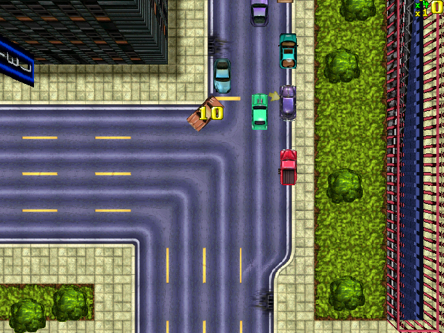

# GTA-eMiYoolator

The original **Grand Theft Auto** (DMA Design, 1997) on the **Miyoo Mini / Mini Plus** with
**OnionOS**. It runs the game's own Windows program, `Grand Theft Auto.exe` from Rockstar's
2002 freeware release: `gtashell` loads the exe and supplies the Windows functions it calls
(DirectDraw, the Miles Sound System, files, registry, keyboard), and
[box86](https://github.com/ptitSeb/box86) translates its x86 code for the Mini's ARM CPU.
Everything on screen is the original game, at its own pace of about 23 frames a second.

Neither this repository nor the release contains any game files. Bring your own copy of the game.



## What you need

- A Miyoo Mini or Mini Plus with OnionOS. Tested on a Mini Plus with OnionOS 4.4.
- The PC version of Grand Theft Auto from Rockstar's 2002 freeware release: the folders
  `WINO`, `GTADATA` and `Music` from its install folder. Of `WINO`, only
  `Grand Theft Auto.exe` is used.

## Install

1. Download `gta-emiyoolator-<version>.zip` from the
   [latest release](https://github.com/uncannyowly/gta-emiyoolator/releases/latest).
2. Extract it to the root of the SD card. The zip holds a `Roms` folder that merges with the
   card's own.
3. Copy `WINO`, `GTADATA` and `Music` from your copy of the game into
   `Roms/PORTS/Games/GTA1-Original/`, so that it looks like this:

   ```text
   Roms/PORTS/Games/GTA1-Original/
     WINO/Grand Theft Auto.exe
     GTADATA/
     Music/
     box86  gtashell  gtaaudio  launch.sh  gtashell.ini  README.txt ...
   ```

4. On the Mini: Games > Ports > Action > Grand Theft Auto (Original). If it is not listed
   yet, run "~Import ports" in the Ports list.

To update, extract a newer zip the same way. It replaces `gtashell.ini`, so keep a copy if you
changed it; your progress (`GTADATA/PLAYER_A.DAT`) stays. To remove the game, delete
`Roms/PORTS/Games/GTA1-Original`, `Roms/PORTS/Shortcuts/Action/Grand Theft Auto (Original).port`
and `Roms/PORTS/Imgs/Grand Theft Auto (Original).png`.

## Controls

| Button | On foot | In a car |
|---|---|---|
| D-pad | Walk the way you press (8 directions). | Steer, accelerate, brake and reverse. |
| A | Attack. | Accelerate. |
| B | The original brake key. | Brake, reverse. |
| X | Special. | Handbrake. |
| Y | Get in or out of a vehicle. Select in menus. | Get out. |
| L1 / R1 | Previous / next weapon. | The same keys, which the original game uses for the radio. |
| L2 | Pause (the P key). | Special: horn, or the RC car's action. |
| START | The original pause screen with the target score (F6). Enter in the menus. | |
| SELECT | City overview, north up. SELECT again closes it. | |
| MENU + SELECT | Esc: back, and the quit question. | |

- MENU alone is left to OnionOS.
- Holding Up and A together keeps accelerating until you let go of both.
- Every button can be changed in `gtashell.ini` (as PC scan codes). `direct = 0` brings back
  the original turn-and-walk controls on foot, and `car_buttons = 0` the older car layout.

## Progress

As in the original, the game saves the stages you have completed, for each character, not
missions or where you are. Finish a stage's score target and play the same character next
time to reach the stages you have unlocked. START shows the target score. Saves are synced
to the card when the game writes them.

## Known issues

- No intro movie.
- No network play (Gather Network and Join Network).
- After you quit, box86 sometimes crashes on its way out. The game has closed by then and
  nothing is lost.
- If something goes wrong, `launch.log` and `gtashell.log` in the game folder hold the logs of
  the last run. Please attach them to an issue.

## How it works

| Part | Where |
|---|---|
| Start-up: configuration, the Windows thread block (FS), the exe's entry point | `src/main.c` |
| PE loader: maps the exe at its image base, points its imports at ours | `src/pe.c` |
| KERNEL32, USER32, GDI32, ADVAPI32 (the registry `GTA Settings.exe` wrote), WINMM, DirectPlay and Smacker stubs | `src/kernel32.c`, `src/user32.c`, `src/misc.c` |
| Windows paths onto the card, names matched ignoring case | `src/files.c` |
| DirectDraw as the exe's SciTech MGL uses it, and the WinDirect DLL MGL loads | `src/ddraw.c`, `src/wdir.c` |
| Miles Sound System: timers, samples and music streams, mixed at 22050 Hz | `src/mss32.c` |
| Frames to `/dev/fb0`, an SDL2 window or PPM files | `src/video.c` |
| Buttons to PC keys, direct walking, the car layout | `src/input.c` |
| City overview drawn from the level's map | `src/mapview.c` |
| Native ARM helper that plays the mix through the Mini's MI_AO driver | `tools/gtaaudio.c` |

`gtashell` is a 32-bit x86 Linux program linked only to libc, libm, libdl and libpthread. On
the Mini, box86 runs it and supplies those libraries as native ARM code. box86 code cannot call
the Mini's audio driver, so `gtashell` pipes its mix into `gtaaudio`. Game settings come from
`gtashell.ini` instead of the registry that `GTA Settings.exe` would have written.

## Building

Everything builds in Docker:

```sh
scripts/build-box86.sh    # box86 for the Mini, at the commit this port is tested with
scripts/build-audio.sh    # gtaaudio
scripts/build-shell.sh    # gtashell (Debian bookworm i386 container)
scripts/test-shell.sh     # tests (32-bit: run it in the i386 container if your host can't)
scripts/package.sh        # dist/gta-emiyoolator-<version>.zip
scripts/deploy-sd.sh /run/media/$USER/CARD "/path/to/Grand Theft Auto"   # install onto a card, game files included
```

box86 and `gtaaudio` build in an image based on `gta1-miyoo-toolchain` (GCC 8.3, glibc 2.28,
Cortex-A7 hard float), which comes from the author's clean-room GTA1 port and is not public yet.

`gtashell` also runs natively on an x86 Linux PC, which is the quickest way to debug it. Give it
an ini with `exe`, `gtadata` and `music` paths plus `video = sdl2` and `input = sdl2` (32-bit
SDL2 is needed for the window), and point `gtadata` at a copy of `GTADATA`, because the game
writes to it. `audio_wav = mix.wav` records the sound.

## License

The port's own code is MIT licensed ([LICENSE](LICENSE)). The release zip includes
[box86](https://github.com/ptitSeb/box86) (MIT, (c) Sebastien Chevalier "ptitSeb"), with its
license next to it as `box86-LICENSE.txt`. Grand Theft Auto is (c) Rockstar Games. This
project is not affiliated with Rockstar Games or Take-Two Interactive, and no part of the game
is in this repository or the release.
